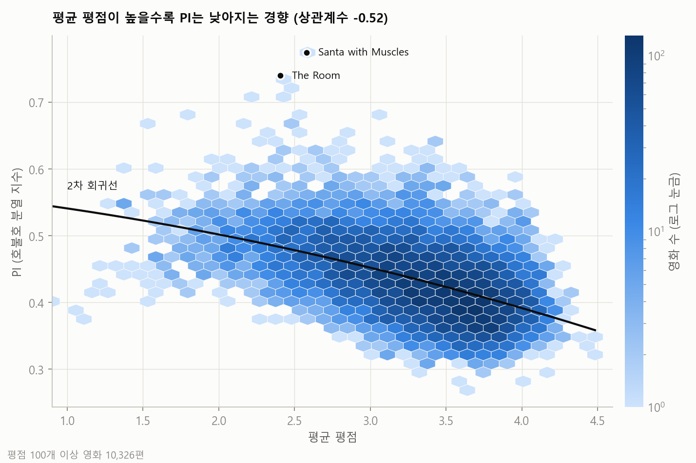
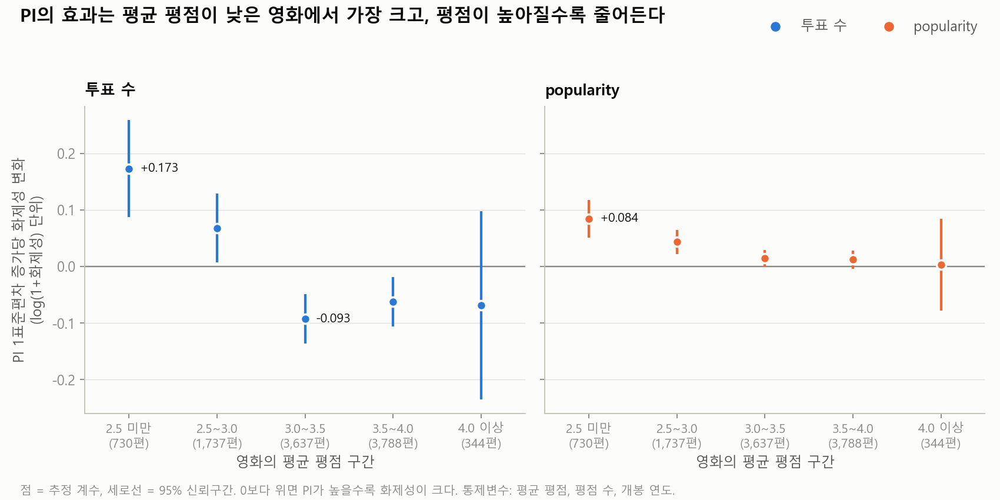
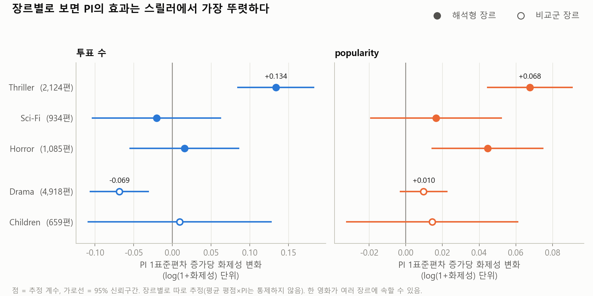

# 호불호 분열 지수(PI)와 화제성 분석 — "평균 평점의 함정"

평균 평점이 같아도 **"모두 3점"인 영화**와 **"절반은 5점, 절반은 1점"인 영화**는 다릅니다.
이 프로젝트는 평점이 갈리는 정도를 **호불호 분열 지수(PI)** 로 수치화하고, PI가 영화의 화제성(TMDB 투표 수·popularity)과 어떤 관계인지 분석합니다.

> 지산학 캡스톤멘토링(2026-2학기) 및 빅데이터 과목 프로젝트

## 핵심 지표

```
PI = 영화별 평점 표준편차 / 2.25
```

- 평점이 0.5~5.0이라 표준편차의 최댓값이 2.25입니다. 이 값으로 나눠 PI를 0~1로 맞췄습니다.
- 평점 수가 **100개 이상**인 영화만 사용합니다 (50/100/200 비교 후 채택).
- PI가 평균 평점의 영향을 받는 구조(평균이 양 끝이면 표준편차가 작아짐)라서, 보정 PI 2종을 민감도 분석에 함께 썼습니다.

## 데이터

| 데이터 | 용도 | 비고 |
|---|---|---|
| [MovieLens 25M](https://grouplens.org/datasets/movielens/25m/) | 평점 25,000,095건, 영화 정보, 장르 | 재배포 금지 조건이라 이 저장소에 포함하지 않음 |
| [TMDB API](https://www.themoviedb.org/) | popularity, vote_count, vote_average | 2026-11-11에 수집. 값은 수집 시점 기준 |

저장소에는 코드와 결과 CSV만 있고, 원본 데이터(`data/`)와 API 키(`.env`)는 포함하지 않습니다.

## 분석 흐름과 규모

| 단계 | 내용 | 규모 |
|---|---|---|
| PI 계산 | 평점 100개 이상 영화 | 10,326편 |
| TMDB 결합 | 화제성 지표를 확보한 영화 | 10,244편 (TMDB에 없음 77편, tmdbId 결측 5편 제외) |
| 회귀 분석 | 개봉 연도를 알 수 있는 영화 | 10,236편 |

종속변수는 TMDB 투표 수와 popularity(모두 log(1+x) 변환), 통제변수는 평균 평점·평점 수(log)·개봉 연도입니다. PI는 표준화(1 표준편차 단위)해서 해석했고, 표준오차는 HC3를 사용했습니다.

## 주요 결과

| 가설 | 내용 | 결과 |
|---|---|---|
| H1 | 평균 평점·평점 수를 통제해도 PI가 높을수록 화제성이 크다 | 투표 수: 관계 없음 (p=0.79) / popularity: 작은 양(+)의 관계 (PI 1표준편차당 약 +2.9%, p<0.001) |
| H2 | 스릴러·SF·호러에서 PI 효과가 드라마·가족물보다 크다 | **부분 지지.** 스릴러에서는 뚜렷했고 SF는 효과가 없었음. 두 그룹 비교는 평균 평점 영향을 통제하면 차이가 사라짐 |
| H3 | 평균 평점과 화제성은 비선형이며 PI가 높은 구간에서만 양(+) | 비선형(∩ 모양)은 지지. 다만 PI 효과는 평균 평점이 낮은 영화(3.0 미만)에서 양(+), 높은 영화에서는 음(-) 또는 무관해 가설과 반대 방향 |
| H4 | PI와 화제성의 관계는 '평점 수(인기)' 효과 때문이다 | 지지되지 않음. 평점 수를 통제하기 전후로 PI 계수가 거의 변하지 않음 |

**한 줄 요약:** PI의 효과는 영화의 평균 평점 수준에 따라 달라집니다. 평균이 낮은 영화에서는 호불호가 갈릴수록 화제성이 컸고, 평균이 높은 영화에서는 그렇지 않았습니다. 화제성을 가장 크게 설명한 변수는 PI가 아니라 평점 수였습니다.

### 그림

**1. PI와 평균 평점의 관계** — 평균 평점이 높을수록 PI가 낮아지는 경향이 있어(상관계수 -0.52), 평균 평점을 통제할 필요가 있었습니다.



**2. H3 — 평균 평점 구간별 PI 효과** — 평균 평점이 낮은 영화일수록 PI가 화제성을 높이는 효과가 컸고, 평점이 높아질수록 효과가 줄었습니다. 투표 수는 평균 평점 3.0 이상에서 오히려 음(-)이었습니다.



**3. H2 — 장르별 PI 효과** — 스릴러에서는 투표 수·popularity 모두 뚜렷했고, SF는 효과가 없었습니다. 장르별 분석은 평균 평점×PI를 통제하지 않았습니다.



그림 속 값은 `results/h2_regression.csv`, `results/h3_regression.csv`와 같은 숫자이고, 표로도 확인할 수 있습니다. 세부 수치는 `results/h1_regression.csv` ~ `results/h4_regression.csv`에 있습니다.

## 한계

- 상관관계이며, 인과관계로 해석할 수 없습니다.
- popularity는 2026-11-11 시점의 값이라 최근 관심(재개봉·스트리밍 등)이 섞였을 수 있습니다.
- 통계 검정을 여러 번 했지만 다중 검정 보정은 하지 않았습니다. 경계에 가까운 결과는 약하게 해석해야 합니다.
- H2의 장르별 분석은 PI × 평균 평점을 통제하지 않았고, 장르 간 차이를 공식적으로 검정하지 않았습니다. 한 영화가 여러 장르에 속해 표본이 겹칩니다.
- 평균 평점 4.0 이상 구간은 344편뿐이라 결과가 불확실합니다.
- MovieLens에 같은 영화가 중복 등록된 경우(tmdbId 기준 2건)가 있어, 해당 영화들은 같은 화제성 값을 공유합니다.
- MovieLens 태그 수를 화제성으로 쓰는 분석과 MIN_RATINGS 50/200에서의 회귀 민감도 분석은 아직 하지 않았습니다.

## 폴더 구조

```
src/      분석 코드
sql/      테이블 생성문, 분석 쿼리
results/  결과 CSV
data/     원본 데이터 (저장소에 포함하지 않음)
```

| 파일 | 역할 |
|---|---|
| `src/pi.py` | PI 계산 → `results/pi_by_movie.csv` |
| `src/compare_min_ratings.py` | MIN_RATINGS 50/100/200별 PI 상위 10편 비교 |
| `src/pi_adjusted.py` | 평균 평점 영향을 보정한 PI 비교 |
| `src/genre_dummies.py` | 장르 더미 변수와 해석형·비교군 그룹 생성 |
| `src/tmdb_fetch.py` | TMDB 화제성 지표 수집 (중간 저장·이어받기 지원) |
| `src/load_db.py` | CSV를 SQLite(`data/movies.db`)에 적재 |
| `src/h1_regression.py` ~ `h4_regression.py` | 가설별 회귀 분석 |
| `src/make_figures.py` | 결과 그래프 3종 생성 → `results/figures/` |
| `sql/01_create_tables.sql` | 테이블 4개와 분석용 뷰(`analysis_base`) |
| `sql/02_analysis_queries.sql` | 분석 쿼리 모음 |

## 실행 방법

1. [MovieLens 25M](https://grouplens.org/datasets/movielens/25m/)을 내려받아 `data/ml-25m/`에 풀어 둡니다.
2. 패키지를 설치합니다.
   ```
   pip install -r requirements.txt
   ```
3. 프로젝트 폴더에 `.env` 파일을 만들고 TMDB API 키를 넣습니다. (이 파일은 Git에 올리지 않습니다.)
   ```
   TMDB_API_KEY=발급받은_키
   ```
4. 아래 순서로 실행합니다. Windows에서 한글이 깨지면 `-X utf8`를 붙입니다.
   ```
   python -X utf8 src/pi.py
   python -X utf8 src/pi_adjusted.py
   python -X utf8 src/genre_dummies.py
   python -X utf8 src/tmdb_fetch.py        # 약 1만 건, 수십 분 소요. 끊겨도 다시 실행하면 이어서 진행
   python -X utf8 src/load_db.py
   python -X utf8 src/h1_regression.py     # h2, h3, h4도 같은 방식
   python -X utf8 src/make_figures.py      # 그래프 생성 (h2, h3 결과 CSV 필요)
   ```
   그래프 글꼴은 Windows의 맑은 고딕입니다. 다른 운영체제에서는 `src/make_figures.py`의 `font.family`를 설치된 한글 글꼴로 바꿔 주세요.
   `src/tmdb_fetch.py`는 처음에 `--limit 5`로 5편만 시험 호출해 볼 수 있습니다.

`popularity`는 수집 시점에 따라 값이 달라지므로, 다시 수집하면 결과가 이 문서와 조금 다를 수 있습니다.

## 출처와 이용 조건

**TMDB**

This product uses TMDB and the TMDB APIs but is not endorsed, certified, or otherwise approved by TMDB.

이 프로젝트는 TMDB 및 TMDB API를 사용하지만, TMDB의 보증·인증·승인을 받은 것이 아닙니다. 학습·포트폴리오 목적의 비상업적 용도로만 사용했습니다.

**MovieLens**

F. Maxwell Harper and Joseph A. Konstan. 2015. The MovieLens Datasets: History and Context. *ACM Transactions on Interactive Intelligent Systems (TiiS)* 5, 4: 19:1–19:19. <https://doi.org/10.1145/2827872>

MovieLens 데이터는 재배포가 금지되어 있어 이 저장소에 포함하지 않았습니다. University of Minnesota 및 GroupLens Research의 보증을 암시하지 않습니다.
